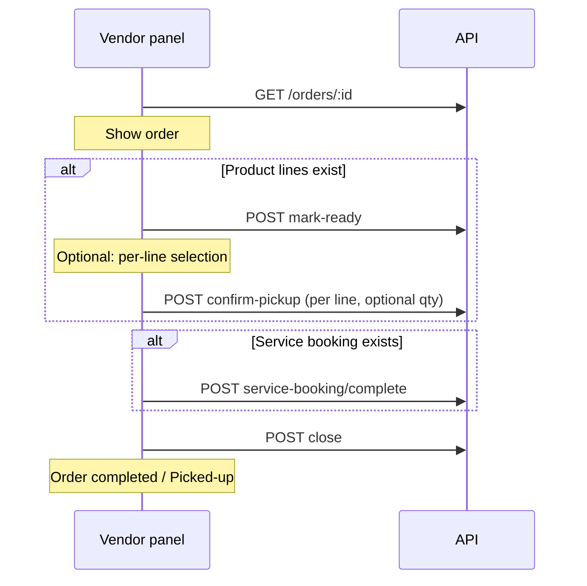

# Phase 2: Vendor Panel Self-Pickup Fulfillment UI

**Audience:** Agent or developer implementing vendor-panel UI on `main` branch.  
**Backend:** NestJS API (`pickbazar-react/api/api server rest`) — Phase 1 fulfillment APIs are already implemented.  
**Scope:** Vendor panel frontend only. **Do not** change checkout/place-order flows in mobile or admin.

---

## 1. Business context (locked decisions)

### What we are building

Self-pickup for **products** and in-store fulfillment for **services** (haircut, café, etc.) on a **single-shop** order. Customer places order via existing `POST /orders` + Razorpay; vendor fulfills via **new APIs** (not a new checkout).

### Locked product rules

| Topic | Decision |
|-------|----------|
| Order composition | One checkout can include **products + services**; each track fulfilled separately |
| Shops per order | Single shop (API does not hard-block multi-shop for legacy; UI should assume one shop) |
| Payment | Primary flow is **Razorpay**; COD still works on API for backward compatibility |
| Pickup location | Always **shop address** (from `order.shop`) |
| Pickup time slot | **None** for now |
| 10-minute rule | `pickup_available_at = paid_at + 10 minutes`. Customer sees **“Ready for pickup”** only after that window **and** vendor marked lines ready |
| Verification | **Order number** (`tracking_number`) only — show prominently on vendor detail |
| Partial pickup | **Allowed** per product line (`quantity` on confirm-pickup) |
| Service fulfillment | Vendor **marks service completed** (no QR/redemption in Phase 2) |
| Café / service qty | One booking per order; **quantities** visible to vendor on service items |
| Order completion | Service booking complete does **not** auto-close order; vendor must **Close order** |
| Customer-facing done label | **“Picked-up”** when order `completed` |
| Unable to fulfill | **Auto Razorpay partial refund** (same as partial cancel) + reason required |
| Unable to fulfill if not picked up | No auto action — manual admin contact later |
| Reviews | Unlock after order `completed` (backend) |
| Legacy delivery statuses | **Keep in API/DB**; hide from dropdown for self-pickup orders in UI |
| Checkout APIs | **Unchanged** — same `POST /orders` and `POST /orders/payment` |
| Backward compatibility | **Must not break** old orders or generic `PUT /orders/:id` status flow |

### Fulfillment model (backend)

- **Order header:** payment + overall lifecycle (`processing` → optional `ready-for-pickup` → `completed` when closed)
- **Product lines:** `fulfillment_status` per `order_items` row
- **Service booking:** separate `service_bookings_orders` row linked to order
- **Close order:** explicit vendor action when all tracks are terminal

---

## 2. Backend API reference

### Base URL & auth

- **Prefix:** `/api`
- **Env in vendor panel:** `NEXT_PUBLIC_REST_API_ENDPOINT` (default `http://localhost:9000/api`)
- **Auth:** `Authorization: Bearer <token>` from `AUTH_CRED` cookie (`src/utils/auth-utils.ts`)
- **Roles for fulfillment endpoints:** `store_owner`, `super_admin`
- **Response envelope:** `{ code, status, message, data }` — order payload is in `data` for mutation endpoints using `ResponseUtil.success`

### Existing endpoints (unchanged — keep working)

| Method | Path | Purpose |
|--------|------|---------|
| `GET` | `/orders` | Paginated vendor orders (`shop_id`, `tracking_number`, `page`, `limit`, `language`) |
| `GET` | `/orders/:id` | Order detail (UUID or `order_number`) |
| `PUT` | `/orders/:id` | Legacy status update `{ order_status }` |
| `POST` | `/download-invoice-url` | Invoice download |

### New fulfillment endpoints (Phase 2 UI must wire these)

All require `JwtAuthGuard` + `RolesGuard` (`store_owner` | `super_admin`).

| Method | Path | Body | Success message |
|--------|------|------|-----------------|
| `POST` | `/orders/:id/product-lines/mark-ready` | `{ order_item_ids?: string[] }` — omit to mark all active product lines | Product lines marked ready for pickup |
| `POST` | `/orders/:id/product-lines/:itemId/confirm-pickup` | `{ quantity?: number }` — default = all remaining | Product pickup confirmed |
| `POST` | `/orders/:id/product-lines/:itemId/unable-to-fulfill` | `{ reason: string }` **required** | Product line marked unable to fulfill |
| `POST` | `/orders/:id/service-booking/complete` | _(empty)_ | Service booking marked completed |
| `POST` | `/orders/:id/service-booking/unable-to-fulfill` | `{ reason: string }` **required** | Service booking marked unable to fulfill |
| `POST` | `/orders/:id/close` | _(empty)_ | Order closed successfully |

`:id` accepts order UUID or `tracking_number` / `order_number`.

### Status values

**Order header (`order_status` / DB `status`):**

| API slug | Meaning |
|----------|---------|
| `order-pending` | Before payment |
| `order-processing` | Paid; fulfillment in progress |
| `order-ready-for-pickup` | All active product lines marked ready (aggregate) |
| `order-completed` | Vendor closed order → show **Picked-up** to customer |
| `order-cancelled` | Cancelled / all lines unable to fulfill |
| `order-at-local-facility`, `order-out-for-delivery` | Legacy delivery — keep for old orders, hide in self-pickup UI |

**Product line `fulfillment_status` (DB snake_case):**

| Value | Vendor meaning |
|-------|----------------|
| `preparing` | Default after Razorpay payment |
| `ready_for_pickup` | Vendor marked ready |
| `picked_up` | Vendor confirmed handover (full line qty) |
| `unable_to_fulfill` | Vendor cannot fulfill (+ refund) |

**Service booking `status`:**

| Value | Meaning |
|-------|---------|
| `pending` | Created after payment |
| `completed` | Vendor marked service done |
| `unable_to_fulfill` | Vendor cannot fulfill (+ refund) |
| `cancelled` | From cancel flow |

### Vendor action rules (enable/disable buttons)

**Mark ready**

- Order status: `processing` or `ready-for-pickup`
- Line: active product line, `fulfillment_status` not `picked_up` / `unable_to_fulfill`

**Confirm pickup**

- Line: `fulfillment_status === ready_for_pickup`
- `quantity` ≤ `quantity - picked_up_quantity`

**Unable to fulfill (product)**

- Line: active, not already `picked_up` / `unable_to_fulfill`
- Refund = `unit_price × remaining_quantity`

**Complete service**

- Booking exists, status not terminal

**Close order**

- All active product lines terminal: `picked_up` or `unable_to_fulfill` (or fully picked via partial qty)
- If order has service lines: booking `completed` | `unable_to_fulfill` | `cancelled`
- Order status: `processing` or `ready-for-pickup`
- Result: `completed` (or `cancelled` if everything unable)

### Extended `GET /orders/:id` response fields (additive)

Existing fields unchanged. New fields (may be `null` on old orders):

```typescript
// Order-level (additive)
paid_at?: string | null;                    // IST in responses via TimezoneInterceptor
pickup_available_at?: string | null;
preferred_pickup_time?: string | null;
closed_at?: string | null;
delivery_time?: string;                       // same as legacy notes for delivery_time
can_show_ready_for_pickup?: boolean;          // customer-facing gate (vendor can show read-only hint)
customer_status_label?: string;             // "Preparing" | "Ready for pickup" | "Picked-up" | ...

product_fulfillment?: {
  lines: Array<{
    id: string;                               // order_item UUID — use for API paths
    fulfillment_status?: string | null;
    quantity?: number;
    picked_up_quantity?: number;
    ready_for_pickup_at?: string | null;
    picked_up_at?: string | null;
    unable_to_fulfill_reason?: string | null;
    line_status?: string;                     // active | cancelled
    item_kind?: string;                       // product
  }>;
};

service_fulfillment?: {
  booking_id: string;
  booking_number: string;
  status?: string;
  payment_status?: string;
  items: Array<{
    id: string;
    quantity: number;
    unit_price: number;
    total_price: number;
    service_offering?: { id: string; name: string; slug: string } | null;
  }>;
} | { booking_id: null; status: string; items: [] } | null;

// Per item in order.items[] (additive)
fulfillment_status?: string | null;
picked_up_quantity?: number;
item_kind?: 'product' | 'service';
```

**Detect self-pickup order in UI:**

```typescript
function isSelfPickupOrder(order: Order): boolean {
  return Boolean(order.paid_at && order.product_fulfillment?.lines?.length);
}
```

**Match product line to `products[]` table:** Join `product_fulfillment.lines[].id` with `order.items[].id` or enrich rows from `items` where `item_kind !== 'service'`.

### Database migration (ops)

Backend migration: `api/api server rest/src/database/migrations/071_orders_self_pickup_fulfillment.sql`  
Must be applied on API database before fulfillment mutations work.

---

## 3. Vendor panel codebase context

### Project root

```
pickbazar-react/admin/vendor admin panel rest/
```

- **Package:** `@marvel/admin-rest`
- **Stack:** Next.js 13 (Pages Router), React 18, TypeScript, react-query 3, axios, next-i18next, Tailwind
- **Dev:** `npm run dev:admin-rest` (port 3002) from monorepo root

### Key directories

| Path | Purpose |
|------|---------|
| `src/pages/[shop]/orders/` | Shop-scoped order routes |
| `src/pages/orders/` | Super-admin order routes |
| `src/components/order/` | Order UI components |
| `src/data/order.ts` | react-query hooks |
| `src/data/client/order.ts` | HTTP client |
| `src/data/client/api-endpoints.ts` | Endpoint constants |
| `src/data/client/http-client.ts` | Axios + auth |
| `src/types/index.ts` | `Order` interface (~line 818) |
| `src/utils/order-status.ts` | Status dropdown constants |
| `src/components/order/status-color.tsx` | Badge colors |
| `public/locales/en/` | i18n (`common.json`, `form.json`, `table.json`) |
| `src/settings/site.settings.ts` | Sidebar nav |

### Current order routes

| Route | File |
|-------|------|
| `/{shop}/orders` | `src/pages/[shop]/orders/index.tsx` |
| `/{shop}/orders/{orderId}` | `src/pages/[shop]/orders/[orderId]/index.tsx` |
| `/orders` (super-admin) | `src/pages/orders/index.tsx` |
| `/orders/{orderId}` | `src/pages/orders/[orderId]/index.tsx` |

### Current order detail behavior

File: `src/pages/[shop]/orders/[orderId]/index.tsx`

- Loads order via `useOrderQuery({ id, language })`
- Product table from `order.products` (pivot quantity/subtotal)
- **Only vendor action today:** `SelectInput` + `useUpdateOrderMutation` → `PUT orders/:id` with `{ order_status }`
- Uses `ORDER_STATUS.slice(0, 6)` in dropdown (pending → cancelled; excludes refunded/failed)
- `OrderStatusProgressBox` — **delivery-centric** 5-step timeline
- Invoice: `useDownloadInvoiceMutation`
- Auth: `adminOwnerAndStaffOnly` + shop ownership via `useShopQuery` + `useMeQuery`

### Current data layer

`src/data/order.ts`:

- `useOrdersQuery` → `GET orders`
- `useOrderQuery` → `GET orders/:id`
- `useUpdateOrderMutation` → `PUT orders/:id`

`src/data/client/order.ts` — `crudFactory` + `get`, `paginated`, `downloadInvoice`, `orderSeen`.

**No fulfillment client methods exist yet.**

### Current `Order` type gaps

`src/types/index.ts` — `Order` has `products[]`, `order_status`, `delivery_time`, etc.  
**Missing:** `paid_at`, `product_fulfillment`, `service_fulfillment`, `customer_status_label`, line fulfillment fields.

### UI kit

Custom Tailwind components: `Button`, `Badge`, `Table`, `SelectInput`, `Card`, `Modal`, `Loader` under `src/components/ui/`.  
Pattern: `react-hook-form`, `react-toastify`, `useTranslation()`.

### i18n pattern

Status badges: `t(order_status)` — key must match API slug (e.g. `order-pending` in `common.json`).

---

## 4. UX specification

### 4.1 Vendor journey



### 4.2 Order detail page layout (target)

```
┌─────────────────────────────────────────────────────────┐
│ OrderViewHeader                                         │
│  Order #ORD-xxx  |  customer_status_label  |  payment    │
│  pickup_available_at (vendor hint)  | preferred_pickup  │
├─────────────────────────────────────────────────────────┤
│ OrderSelfPickupProgress  (if self-pickup)               │
│  Confirmed → Preparing → Ready → Picked up → Closed     │
├─────────────────────────────────────────────────────────┤
│ OrderProductFulfillmentCard  (if product lines)         │
│  [Mark all ready]  [Mark selected ready]                │
│  Table: product | qty | picked | status | actions       │
│    [Confirm pickup] [Unable to fulfill] per line        │
├─────────────────────────────────────────────────────────┤
│ OrderServiceFulfillmentCard  (if service_fulfillment)   │
│  Booking # | items + quantities | status                │
│  [Mark service completed] [Unable to fulfill]           │
├─────────────────────────────────────────────────────────┤
│ OrderCloseButton                                        │
│  [Close order] (disabled + tooltip until rules pass)    │
├─────────────────────────────────────────────────────────┤
│ (Existing) Customer, addresses, totals, products table  │
│ Legacy status dropdown — hidden if isSelfPickupOrder()  │
└─────────────────────────────────────────────────────────┘
```

### 4.3 Orders list (optional polish)

- Add column or badge: `customer_status_label` or derived short text
- Color for `order-ready-for-pickup`
- **Do not remove** existing `order_status` column

### 4.4 Modals

**Unable to fulfill (product line or service):**

- Required textarea: `reason`
- Confirm → calls respective unable-to-fulfill endpoint
- Toast success; invalidate order query

**Confirm pickup (if partial qty):**

- Optional number input: quantity (default = remaining)
- Confirm → `confirm-pickup`

### 4.5 Progress box

Replace or branch `OrderStatusProgressBox`:

| Step | Self-pickup |
|------|-------------|
| 1 | Order confirmed (`order-processing` after pay) |
| 2 | Preparing (any line `preparing`) |
| 3 | Ready for pickup (lines `ready_for_pickup` or order `order-ready-for-pickup`) |
| 4 | Picked up (all product lines terminal) |
| 5 | Closed (`order-completed`) |

For **legacy orders** (`!paid_at`): keep existing delivery progress component.

### 4.6 Notifications (backend — no UI work)

Customer receives push on: ready for pickup, picked up, unable to fulfill. Vendor already gets new-order on payment.

---

## 5. Implementation plan

### Phase 2a — Foundation (do first)

**Goal:** Types, API client, hooks, i18n, badge for new status — no page layout changes yet.

| Task | Files |
|------|-------|
| Extend `Order` + fulfillment types | `src/types/index.ts` |
| Add endpoint helpers | `src/data/client/api-endpoints.ts` |
| Add client methods | `src/data/client/order.ts` or `src/data/client/order-fulfillment.ts` |
| Add react-query mutations | `src/data/order.ts` |
| Add `order-ready-for-pickup` to status list + colors | `src/utils/order-status.ts`, `status-color.tsx` |
| Add fulfillment helpers | `src/utils/order-fulfillment.ts` (new) |
| i18n keys | `public/locales/en/common.json`, `form.json`, `table.json` |

**Suggested hooks:**

```typescript
useMarkProductLinesReadyMutation()
useConfirmProductPickupMutation()
useUnableToFulfillProductLineMutation()
useCompleteServiceBookingMutation()
useUnableToFulfillServiceBookingMutation()
useCloseOrderMutation()
```

Each: `onSuccess` → toast + `queryClient.invalidateQueries(API_ENDPOINTS.ORDERS)`.

**HTTP example:**

```typescript
HttpClient.post(`${API_ENDPOINTS.ORDERS}/${orderId}/product-lines/mark-ready`, {
  order_item_ids: optionalIds,
});
```

### Phase 2b — Order detail: product track

| Task | Files |
|------|-------|
| `OrderProductFulfillmentCard` | `src/components/order/order-product-fulfillment-card.tsx` |
| `UnableToFulfillModal` | `src/components/order/unable-to-fulfill-modal.tsx` |
| Wire into detail page | `src/pages/[shop]/orders/[orderId]/index.tsx` |
| Extend header | `src/components/order/order-view-header.tsx` |

### Phase 2c — Order detail: service track

| Task | Files |
|------|-------|
| `OrderServiceFulfillmentCard` | `src/components/order/order-service-fulfillment-card.tsx` |
| Wire actions + unable modal reuse | detail page |

### Phase 2d — Close order + progress + legacy dropdown

| Task | Files |
|------|-------|
| `OrderCloseButton` | `src/components/order/order-close-button.tsx` |
| `OrderSelfPickupProgress` | `src/components/order/order-self-pickup-progress.tsx` |
| Hide legacy `SelectInput` when `isSelfPickupOrder(order)` | detail page |
| Keep `PUT` status for legacy orders only | detail page |

### Phase 2e — List polish

| Task | Files |
|------|-------|
| Fulfillment summary column/badge | `order-list.tsx`, list page |

### Phase 2f — Super-admin parity

Mirror components on:

- `src/pages/orders/[orderId]/index.tsx`
- `src/pages/orders/index.tsx` (list)

Use `admin` layout instead of `ShopLayout`.

### Phase 2g — QA

See §9.

### Phase 3 — Vendor web notifications (after 2g)

See **§12**. Requires new API module in API repo first, then wire `RecentOrderBar` in vendor panel.

---

## 6. Code patterns to follow

### Mutations (match `useUpdateOrderMutation`)

```typescript
export const useMarkProductLinesReadyMutation = () => {
  const { t } = useTranslation();
  const queryClient = useQueryClient();
  return useMutation(
    ({ id, order_item_ids }: { id: string; order_item_ids?: string[] }) =>
      orderClient.markProductLinesReady(id, { order_item_ids }),
    {
      onSuccess: () => toast.success(t('common:successfully-updated')),
      onError: (error) => toast.error(getApiErrorMessage(error)),
      onSettled: () => queryClient.invalidateQueries(API_ENDPOINTS.ORDERS),
    },
  );
};
```

### Fulfillment helper example

```typescript
// src/utils/order-fulfillment.ts
export function canCloseOrder(order: Order): boolean {
  // Mirror backend rules — use for disabling Close button + tooltip
}

export function getRemainingPickupQty(line: ProductFulfillmentLine): number {
  return Math.max(0, (line.quantity ?? 0) - (line.picked_up_quantity ?? 0));
}
```

### Backward compatibility on detail page

```typescript
const showFulfillmentUi = Boolean(order?.paid_at);

{showFulfillmentUi && <OrderProductFulfillmentCard order={order} />}
{showFulfillmentUi && order?.service_fulfillment?.booking_id && (
  <OrderServiceFulfillmentCard order={order} />
)}

{!showFulfillmentUi && (
  // existing status SelectInput + OrderStatusProgressBox unchanged
)}
```

---

## 7. i18n keys to add (`public/locales/en/`)

### `common.json`

```json
{
  "order-ready-for-pickup": "Ready for pickup",
  "text-picked-up": "Picked-up",
  "text-preparing": "Preparing",
  "text-product-pickup-track": "Product pickup",
  "text-service-track": "Service fulfillment",
  "text-fulfillment-status": "Fulfillment status",
  "text-picked-up-qty": "Picked up",
  "text-pickup-available-after": "Customer can see ready after",
  "text-unable-to-fulfill": "Unable to fulfill"
}
```

### `form.json`

```json
{
  "button-mark-ready": "Mark ready for pickup",
  "button-mark-all-ready": "Mark all ready",
  "button-confirm-pickup": "Confirm picked up",
  "button-mark-service-complete": "Mark service completed",
  "button-close-order": "Close order",
  "button-unable-to-fulfill": "Unable to fulfill",
  "input-label-unable-reason": "Reason",
  "input-label-pickup-quantity": "Quantity picking up now",
  "placeholder-unable-reason": "Explain why this cannot be fulfilled"
}
```

### `table.json`

```json
{
  "table-item-fulfillment": "Fulfillment",
  "table-item-picked-quantity": "Picked / Ordered"
}
```

Duplicate keys in other locale folders if the project ships them.

---

## 8. Open decisions (confirm with product owner if unclear)

| # | Question | Recommendation |
|---|----------|----------------|
| 1 | Enable Orders in **staff** sidebar? (`site.settings.ts` has staff orders commented) | **Yes** — same as store_owner fulfillment actions |
| 2 | Partial pickup UI | Default confirm = **all remaining**; optional “Pick partial quantity” expand |
| 3 | Legacy status dropdown on self-pickup orders | **Hide** for `store_owner`; keep for `super_admin` only |
| 4 | Super-admin in same PR? | **After** shop routes work (2f) |
| 5 | Locales | **English first**; copy keys to other locales in follow-up |

---

## 9. QA checklist

### Legacy compatibility

- [ ] Old order without `paid_at` — detail page looks **unchanged** (dropdown + delivery progress)
- [ ] `PUT /orders/:id` status change still works on legacy orders
- [ ] List page loads; no errors when new fields are absent

### Product-only order

- [ ] After API payment: lines show `preparing`
- [ ] Mark ready → `ready_for_pickup`; order `order-ready-for-pickup`
- [ ] Confirm pickup (full) → `picked_up`
- [ ] Close → `order-completed`; `customer_status_label` = Picked-up

### Partial pickup

- [ ] Line qty 3: confirm 1, then 2 → line becomes `picked_up`

### Service-only order

- [ ] Service card shows items + quantities
- [ ] Complete service → booking `completed`
- [ ] Close order → completed

### Mixed order

- [ ] Both cards visible
- [ ] Can complete product + service independently
- [ ] Close disabled until **both** tracks terminal

### Unable to fulfill

- [ ] Reason required
- [ ] Refund toast / order refresh shows updated totals
- [ ] Close still works when remaining lines terminal

### Error handling

- [ ] 403 for wrong shop
- [ ] 400 when confirming pickup before ready
- [ ] Toast shows API error message via `getApiErrorMessage`

---

## 10. Out of scope for Phase 2 (fulfillment UI only)

- Customer/mobile app screens
- New checkout / place-order UI
- QR / OTP pickup verification
- Pickup time slot picker
- Service redemption codes UI
- Auto “contact customer” if not picked up
- **Vendor web notifications** → **Phase 3** (§12)
- Pusher / browser desktop notifications (optional later)

---

## 11. Related backend source (for debugging)

| Area | Path (API repo) |
|------|-----------------|
| Fulfillment service | `src/orders/order-fulfillment.service.ts` |
| Controller routes | `src/orders/orders.controller.ts` |
| Order response mapping | `src/orders/orders.service.ts` → `formatOrderForClient` |
| DTOs | `src/orders/dto/order-fulfillment.dto.ts` |
| Status helpers | `src/orders/utils/order-fulfillment.util.ts` |
| Migration | `src/database/migrations/071_orders_self_pickup_fulfillment.sql` |

---

## 12. Phase 3 — Vendor web notifications (new API module + panel)

**Goal:** Show **new paid orders** in the vendor panel bell + toast. Reuse `RecentOrderBar`; do **not** use customer `GET /notify-logs`.

**Trigger:** Razorpay payment success (`finalizeSuccessfulOrderCheckout`) — not order create (`pending`).

### Why a new module

- Customer `notify-logs` API is mobile/customer-only today.
- FCM `vendor_new_order` is mobile-only, not web inbox.
- `pushNotification.all.order` in settings hides bell when `false` — enable after wiring.

### API module (`api/api server rest`) — additive

**Module:** `src/vendor-notifications/` → register in `app.module.ts`

**Migration `072_vendor_notifications.sql`:**

```sql
vendor_notifications (
  id UUID PK,
  shop_id INT NOT NULL,
  recipient_user_id UUID NOT NULL,  -- shop owner
  order_id UUID NOT NULL,
  order_number VARCHAR(50) NOT NULL,
  type VARCHAR(50) DEFAULT 'order_paid',
  title VARCHAR(255),
  body TEXT,
  is_read BOOLEAN DEFAULT false,
  read_at TIMESTAMP,
  created_at TIMESTAMP
)
-- indexes: recipient_user_id, shop_id, is_read, created_at
```

**Create (internal):** `VendorNotificationsService.createForPaidOrder({ orderId, shopId, ownerUserId, orderNumber, totalAmount, currency })`  
Call from `OrdersService.finalizeSuccessfulOrderCheckout` (same loop as FCM vendor push). Failures logged; must not fail payment response.

**HTTP (JWT, `store_owner` | `super_admin`):**

| Method | Path | Purpose |
|--------|------|---------|
| `GET` | `/vendor-notifications` | `shop_id`, `limit` (default 5), `unread_only` |
| `GET` | `/vendor-notifications/unread-count` | `shop_id` → `{ count }` |
| `PUT` | `/vendor-notifications/:id/read` | Mark one read |
| `PUT` | `/vendor-notifications/read-all` | Body/query: `shop_id` |

**List item shape:**

```typescript
{
  id: string;
  type: 'order_paid';
  order_id: string;
  order_number: string;
  shop_id: number;
  title: string;       // "New order received"
  body: string;        // "{shop}: paid order ORD-xxx"
  is_read: boolean;
  created_at: string;
}
```

**Settings:** Set `options.pushNotification.all.order: true` in DB/settings so navbar shows bell.

### Vendor panel wiring

| Task | File |
|------|------|
| Endpoints | `src/data/client/api-endpoints.ts` |
| Client + hooks | `src/data/client/vendor-notifications.ts`, `src/data/vendor-notifications.ts` |
| Rewire bell | `src/components/layouts/topbar/recent-order-bar.tsx` |
| Toast on new | Same file or `useVendorNotificationsPoll` (30s refetch when tab visible) |
| i18n | `text-new-paid-order`, `text-order-is-paid` in `common.json` |
| Navigation | Click → `/{shop}/orders/{order_id}` (use `order_id` UUID, not only order_number) |

**UX:** Unread dot on bell; toast with `toastId: vendor-order-{id}`; mark read on click; “Mark all read” in dropdown.

**Fallback:** If API module not deployed, optional `GET /orders` poll — replace when Phase 3 API is live.

**Out of scope Phase 3:** Pusher, browser Notification API, fulfillment-event notifications (ready/pickup).

### Phase 3 PR split

| PR | Repo | Contents |
|----|------|----------|
| **PR4** | API | Migration + module + hook on payment success + settings flag |
| **PR5** | Vendor panel | Hooks + `RecentOrderBar` + toast + i18n |

---

## 13. Suggested PR split (Phase 2 fulfillment)

| PR | Contents |
|----|----------|
| **PR1** | 2a + 2b (types, hooks, product fulfillment card, detail page header) |
| **PR2** | 2c + 2d (service card, close, progress, legacy dropdown branch) |
| **PR3** | 2e + 2f (list polish, super-admin) |

---

## 14. Agent instructions (summary)

**Phase 2 (fulfillment UI):**

1. Read this doc before coding; work in `admin/vendor admin panel rest`.
2. **Do not break** orders without `paid_at` (legacy dropdown + delivery progress).
3. Use fulfillment **POST** endpoints from §2 — not `order_status` PUT alone.
4. Migration `071` must be applied on API DB.

**Phase 3 (notifications):** Implement API PR4 first, then vendor panel PR5. Do not reuse customer `notify-logs` for vendors.

---

*Document version: Phase 2 fulfillment + Phase 3 vendor notifications (July 2026).*
